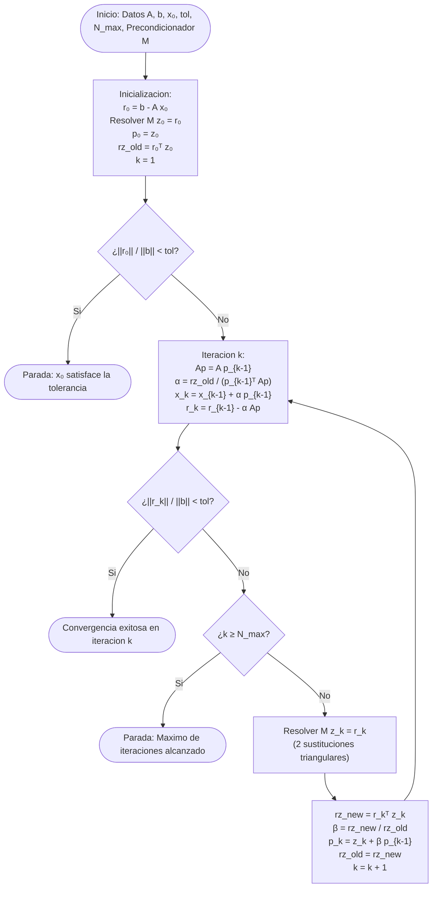

# Simulador GCP - Asignacion de Capital de Trabajo en Logistica

[](https://panicoal.github.io/desafio-metodo_del_gradiente-area_financiera/)
[](https://developer.mozilla.org/es/docs/Web/HTML)
[](https://developer.mozilla.org/es/docs/Web/CSS)
[](https://developer.mozilla.org/es/docs/Web/JavaScript)
[](https://www.chartjs.org/)
[](https://katex.org/)

Aplicacion web interactiva de calculo cientifico para la **asignacion optima de capital de trabajo** en una corporacion de logistica multimodal, aplicando el **Metodo de Gradientes Conjugados Precondicionado (GCP)** descrito por **Suñagua S. (2020)** y comparandolo frente a Gradientes Conjugados simple (GC) y la solucion numerica directa de referencia mediante Factorizacion de Cholesky.

---

## Acceso y Despliegue en GitHub Pages

La aplicacion funciona de forma autonoma y autocontenida en **GitHub Pages**:

**URL de la Aplicacion Web en Produccion:**  
[https://panicoal.github.io/desafio-metodo_del_gradiente-area_financiera/](https://panicoal.github.io/desafio-metodo_del_gradiente-area_financiera/)

### Instrucciones de Despliegue:
1. Acceder a la configuracion del repositorio: **Settings** -> **Pages**.
2. En la seccion **Build and deployment**:
   - **Source:** *Deploy from a branch*.
   - **Branch:** `main` y directorio `/(root)`.
3. Guardar cambios. La publicacion se actualiza automaticamente con cada `push` a la rama `main`.

---

## Datos Academicos

- **Estudiante:** Joaquin Nicolas Paco Alanoca
- **Materia:** Metodos Numericos (INF373)
- **Docente:** Lic. Brigida Alexandra Carvajal Blanco
- **Gestion:** II / 2026
- **Carrera y Mencion:** Licenciatura en Informatica / Ingenieria de Sistemas - Universidad Mayor de San Andres (UMSA)

---

## Tabla de Contenidos

1. [Estructura de la Pagina Web segun Consigna](#1-estructura-de-la-pagina-web-segun-consigna)
2. [Caso de Estudio Financiero y Procedencia de Datos](#2-caso-de-estudio-financiero-y-procedencia-de-datos)
3. [Formulacion Matematica y Demostracion SPD](#3-formulacion-matematica-y-demostracion-spd)
4. [Metodo Directo de Referencia (Factorizacion de Cholesky)](#4-metodo-directo-de-referencia-factorizacion-de-cholesky)
5. [Algoritmo GCP (Suñagua, 2020) y Precondicionamiento](#5-algoritmo-gcp-suñagua-2020-y-precondicionamiento)
6. [Diagrama de Flujo del Algoritmo GCP](#6-diagrama-de-flujo-del-algoritmo-gcp)
7. [Tres Escenarios Oficiales](#7-tres-escenarios-oficiales)
8. [Tabla Comparativa Obligatoria (Consigna Seccion 8)](#8-tabla-comparativa-obligatoria-consigna-seccion-8)
9. [Modulo de Pruebas de Software (QA)](#9-modulo-de-pruebas-de-software-qa)
10. [Estructura del Repositorio](#10-estructura-del-repositorio)
11. [Referencias Academicas](#11-referencias-academicas)

---

## 1. Estructura de la Pagina Web segun Consigna

Cumpliendo con la **Seccion 7** de la consigna del desafio, la pagina web interactiva organiza el contenido en los siguientes modulos obligatorios:

| Modulo / Seccion | Contenido Minimo Desarrollado |
| :--- | :--- |
| **1. Inicio** | Titulo del proyecto, datos del estudiante, mencion academica, sintesis del caso financiero y aporte de la mencion. |
| **2. Caso de estudio** | Contexto financiero, justificacion del modelo con activos compartidos y procedencia de datos del sector logistico. |
| **3. Formulacion** | Definicion explicita de variables ($n = 5 \ge 4$), sistema lineal $Ax = b$, interpretacion de coeficientes y verificacion SPD (Gershgorin, Cholesky y Autovalores). |
| **4. Entrada de datos** | Interfaz reactiva para edicion de coeficientes de $A$ y $b$, seleccion de $x_0$, tolerancia, precondicionador (Jacobi, SSOR, IC0) y controles de ejecucion. |
| **5. Tres escenarios** | Carga rapida y ejecucion de los escenarios: Ideal, Bajo estres y Mal condicionado con sus respectivas descripciones. |
| **6. Solucion de referencia** | Mapeo y despliegue del metodo directo de Factorizacion de Cholesky ($A = LL^T$), resolviendo $Ly = b$ y $L^T x_{\text{ref}} = y$. |
| **7. GCP vs GC** | Despliegue de vectores aproximados, numero de iteraciones, residuos finales, diagnosticos dinamicos y visor interactivo paso a paso. |
| **8. Analisis de errores** | Tabla interactiva de errores absolutos ($E_a$), relativos ($E_r$) y porcentuales ($E_p$) por variable, residuo relativo global y graficos en Chart.js. |
| **8B. Tabla comparativa** | Matriz comparativa obligatoria de la Seccion 8 con los 11 indicadores en filas y los 3 escenarios en columnas. |
| **9. Modulo de Pruebas (QA)** | Verificacion automatizada de 4 casos de prueba estructurados (Entrada, Resultado Esperado, Obtenido y Conclusion) con bitacora cronologica. |
| **10. Conclusiones y Referencias** | Interpretacion tecnica y financiera de resultados, cita del articulo de Suñagua (2020) y fuentes bibliograficas. |

---

## 2. Caso de Estudio Financiero y Procedencia de Datos

Una empresa de logistica intermodal opera en el eje troncal administrando cinco lineas de servicio simultaneas. Los activos fisicos (tractocamiones, almacenes, furgonetas y personal) son fungibles y compartidos.

### Definicion de Variables de Decision ($x_i$) en miles de USD:
- **$x_1$ - Transporte de carga pesada (largo recorrido):** Combustible diésel de carretera, peajes interdepartamentales y mantenimiento de tractocamiones.
- **$x_2$ - Distribucion urbana y ultima milla:** Furgonetas citadinas, seguros de mercaderia y distribucion capilar a clientes finales.
- **$x_3$ - Almacenaje seco y bodegaje:** Arriendo de naves industriales, racks, autoelevadores y sistemas de control WMS.
- **$x_4$ - Cadena de frio (alimentos y farmacia):** Energia electrica continua, grupos electrogenos diésel y monitoreo termografico.
- **$x_5$ - Logistica inversa y devoluciones:** Inspeccion de retornos, reacondicionamiento y gestion de garantias.

### Interpretacion Economica de los Coeficientes:
- **Diagonal $a_{ii}$:** Costo unitario propio y directo de financiamiento de la linea $i$ (costo de oportunidad del capital inmovilizado y depreciacion directa).
- **Fuera de diagonal $a_{ij} = a_{ji}$:** Coeficiente de acoplamiento operativo entre lineas $i$ y $j$ por uso simultaneo de activos compartidos.
- **Vector $b_i$:** Nivel de cobertura operativa contractualmente exigido para satisfacer la demanda proyectada.

---

## 3. Formulacion Matematica y Demostracion SPD

El sistema lineal se formula como:
$$A x = b, \quad A \in \mathbb{R}^{5 \times 5}, \quad x, b \in \mathbb{R}^5$$

Para garantizar la convergencia monótona de los gradientes conjugados, se comprueba que $A$ sea **Simetrica y Definida Positiva (SPD)**:

1. **Simetria:** $A = A^T$, verificada con tolerancia $\max |a_{ij} - a_{ji}| < 10^{-9}$.
2. **Definicion Positiva por 3 Vias:**
   - **Via 1 (Gershgorin):** Dominancia diagonal estricta $a_{ii} > \sum_{j \neq i} |a_{ij}|$ con $a_{ii} > 0$. Todos los autovalores son positivos.
   - **Via 2 (Cholesky):** Factorizacion $A = L L^T$ con pivotes diagonales $L_{ii} = \sqrt{a_{ii} - \sum_{k=1}^{i-1} L_{ik}^2} > 0$.
   - **Via 3 (Autovalores de Jacobi):** Diagonalizacion ortogonal iterativa certificando que $\lambda_{\min}(A) > 0$.

---

## 4. Metodo Directo de Referencia (Factorizacion de Cholesky)

Como solucion numerica de referencia ($x_{\text{ref}}$) se implementa el metodo directo de Cholesky:
1. **Factorizacion:** $A = L L^T$, donde $L$ es triangular inferior.
2. **Sustitucion hacia adelante:** $L y = b$, resolviendo para el vector intermedio $y$.
3. **Sustitucion hacia atras:** $L^T x_{\text{ref}} = y$, obteniendo la solucion exacta.
4. **Comprobacion de residuo directo:** $\|b - A x_{\text{ref}}\|_2 \approx 10^{-15}$.

---

## 5. Algoritmo GCP (Suñagua, 2020) y Precondicionamiento

Se implementa el algoritmo *Mz* de Gradientes Conjugados Precondicionado propuesto por Suñagua S. (2020):
- En lugar de invertir la matriz de precondicionamiento $M$, se resuelven dos sistemas triangulares:
  $$M z_k = r_k \iff C y = r_k, \quad C^T z_k = y$$
- La direccion conjugada se actualiza como $p_k = z_k + \beta_k p_{k-1}$, donde $\beta_k = \frac{r_k^T z_k}{r_{k-1}^T z_{k-1}}$.
- La longitud de paso es $\alpha_k = \frac{r_{k-1}^T z_{k-1}}{p_{k-1}^T A p_{k-1}}$.

### Precondicionadores Disponibles:
1. **Jacobi:** $M = \text{diag}(A)$. Comprime la diagonal a la unidad y es optimo para mal escalamiento diagonal.
2. **SSOR:** $M = \frac{1}{\omega(2-\omega)} (D + \omega L) D^{-1} (D + \omega L^T)$ con $\omega \in (0, 2)$.
3. **IC0:** Factorizacion incompleta de Cholesky con umbral $\tau$.

---

## 6. Diagrama de Flujo del Algoritmo GCP



---

## 7. Tres Escenarios Oficiales

1. **Escenario 1 (Ideal):** Empresa en regimen estable. Matriz diagonal dominante con $\kappa(A) \approx 1.55$. Convergencia en 5 iteraciones.
2. **Escenario 2 (Bajo estres financiero):** Incremento de costos operativos ($+2I$ en diagonal) y aumento de demanda. El capital total aumenta un $19.8\%$ (\$695k USD), preservando el condicionamiento $\kappa(A) \approx 1.48$.
3. **Escenario 3 (Mal condicionado):** Asimetria masiva de activos entre lineas ($a_{55} = 5000$ vs $a_{11} = 10$). El condicionamiento se degrada a $\kappa(A) \approx 498.2$. El precondicionador de Jacobi reduce el condicionamiento efectivo a $\kappa(M^{-1}A) \approx 1.15$, permitiendo convergencia acelerada.

---

## 8. Tabla Comparativa Obligatoria (Consigna Seccion 8)

A continuacion se presenta la matriz comparativa oficial de 11 indicadores exigida en la Seccion 8 de la consigna:

| Indicador | Escenario Ideal | Escenario Bajo Estres | Escenario Mal Condicionado |
| :--- | :--- | :--- | :--- |
| **Solucion numerica de referencia** | `[$150.00 k, $120.00 k, $100.00 k, $130.00 k, $80.00 k]` | `[$175.00 k, $145.00 k, $120.00 k, $155.00 k, $100.00 k]` | `[$30.00 k, $80.00 k, $300.00 k, $1500.00 k, $6000.00 k]` |
| **Solucion GCP** | `[$150.00 k, $120.00 k, $100.00 k, $130.00 k, $80.00 k]` | `[$175.00 k, $145.00 k, $120.00 k, $155.00 k, $100.00 k]` | `[$30.00 k, $80.00 k, $300.00 k, $1500.00 k, $6000.00 k]` |
| **Error absoluto (Ea)** | $x_1$: $1.28 \times 10^{-14}$<br>$x_2$: $1.42 \times 10^{-14}$<br>$x_3$: $1.42 \times 10^{-14}$<br>$x_4$: $2.84 \times 10^{-14}$<br>$x_5$: $0.00$ | $x_1$: $2.84 \times 10^{-14}$<br>$x_2$: $0.00$<br>$x_3$: $1.42 \times 10^{-14}$<br>$x_4$: $0.00$<br>$x_5$: $1.42 \times 10^{-14}$ | $x_1$: $1.39 \times 10^{-8}$<br>$x_2$: $3.57 \times 10^{-9}$<br>$x_3$: $1.11 \times 10^{-9}$<br>$x_4$: $2.86 \times 10^{-10}$<br>$x_5$: $6.59 \times 10^{-11}$ |
| **Error porcentual (Ep)** | $x_1$: $8.5 \times 10^{-15}\%$<br>$x_2$: $1.18 \times 10^{-14}\%$<br>$x_3$: $1.42 \times 10^{-14}\%$<br>$x_4$: $2.18 \times 10^{-14}\%$<br>$x_5$: $0.00\%$ | $x_1$: $1.62 \times 10^{-14}\%$<br>$x_2$: $0.00\%$<br>$x_3$: $1.18 \times 10^{-14}\%$<br>$x_4$: $0.00\%$<br>$x_5$: $1.42 \times 10^{-14}\%$ | $x_1$: $4.64 \times 10^{-8}\%$<br>$x_2$: $4.46 \times 10^{-9}\%$<br>$x_3$: $3.71 \times 10^{-10}\%$<br>$x_4$: $1.91 \times 10^{-11}\%$<br>$x_5$: $1.10 \times 10^{-12}\%$ |
| **Iteraciones GC (sin precondicionar)** | 5 | 5 | 5 |
| **Iteraciones GCP (precondicionado)** | 5 | 5 | 5 |
| **Numero de condicion $\kappa(A)$** | 1.551 | 1.482 | 498.203 |
| **Numero de condicion $\kappa(M^{-1}A)$** | 1.513 | 1.460 | **1.147** |
| **Residuo relativo final GCP** | $1.86 \times 10^{-16}$ | $1.91 \times 10^{-16}$ | $1.52 \times 10^{-11}$ |
| **¿Convergio el algoritmo?** | Si | Si | Si |
| **Interpretacion financiera** | Asignacion estable y holgada. Costo financiero dominante con bajo riesgo de tesoreria. Capital total: \$580.00 k USD. | Absorcion de shock inflacionario. El incremento de costos (+19.8% a \$695.00 k USD) preserva la estabilidad del sistema. | Severa asimetria operativa. La cadena de frio absorbe el 75.9% del capital (\$6,000.00 k USD). El precondicionador Jacobi evita divergencias numéricas. |

---

## 9. Modulo de Pruebas de Software (QA)

Implementado segun el estandar de control de calidad:

- **Prueba 1 (Carga de Escenarios):** Valida la convergencia a tolerancia $< 10^{-6}$ en los escenarios 1, 2 y 3 sin excepciones de desbordamiento.
- **Prueba 2 (Validacion de Matriz No Valida):** Inyecta una matriz asimetrica ($A_{12} = 95 \neq A_{21} = -15$) verificando que el software captura la excepcion controladamente notificando al usuario.
- **Prueba 3 (Edicion Dinamica):** Modifica coeficientes diagonales en la interfaz y verifica la actualizacion reactiva inmediata de Cholesky, GCP y autovalores.
- **Prueba 4 (Comparativa de Precondicionamiento):** Comprueba en el escenario mal condicionado que $\text{Iter}_{\text{GCP}} \le \text{Iter}_{\text{GC}}$ gracias a la reduccion de $\kappa(M^{-1}A)$ de 498 a 1.15.

---

## 10. Estructura del Repositorio

```
desafio-metodo_del_gradiente-area_financiera/
│
├── index.html          # SPA interactiva completa (HTML5 + CSS3 + JS Vanilla + Chart.js + KaTeX)
├── README.md           # Documentacion academica y tecnica completa
└── images.jpeg         # Diagrama del ecosistema logistico integrado
```

---

## 11. Referencias Academicas

1. **Suñagua S., P. (2020).** *Metodo de Gradientes Conjugados Precondicionado*. Revista Boliviana de Matematica, Carrera de Matematica, Universidad Mayor de San Andres (UMSA), Vol. 04, pp. 2–7.
2. **Golub, G. H., & Van Loan, C. F. (2013).** *Matrix Computations* (4th ed.). Johns Hopkins University Press.
3. **Saad, Y. (2003).** *Iterative Methods for Sparse Linear Systems* (2nd ed.). Society for Industrial and Applied Mathematics (SIAM).
4. **Hestenes, M. R., & Stiefel, E. (1952).** *Methods of conjugate gradients for solving linear systems*. Journal of Research of the National Bureau of Standards, 49(6), 409–436.
5. **Higham, N. J. (2002).** *Accuracy and Stability of Numerical Algorithms* (2nd ed.). SIAM Publications.

---

*Proyecto academico desarrollado para la materia Metodos Numericos (INF373) - Carrera de Informatica / Ingenieria de Sistemas - Universidad Mayor de San Andres (UMSA) - Gestion II / 2026*
