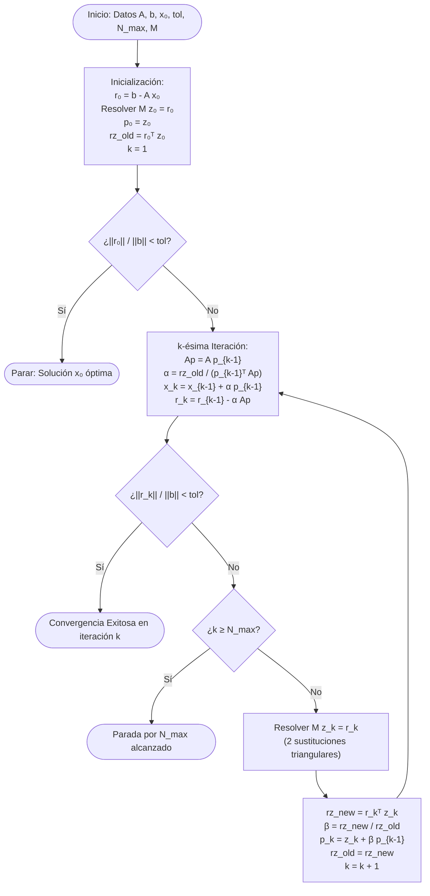

# Simulador GCP · Asignación de Capital de Trabajo en Logística

[](https://panicoal.github.io/desafio-metodo_del_gradiente-area_financiera/)
[](https://developer.mozilla.org/es/docs/Web/HTML)
[](https://developer.mozilla.org/es/docs/Web/CSS)
[](https://developer.mozilla.org/es/docs/Web/JavaScript)
[](https://www.chartjs.org/)
[](https://katex.org/)

Aplicación web interactiva de alto rendimiento que modela la **asignación óptima de capital de trabajo** en una corporación logística multimodal mediante el **Método de Gradientes Conjugados Precondicionado (GCP)**, implementando el algoritmo *Mz* descrito por **Suñagua S. (2020)** y comparándolo frente al Gradiente Conjugado convencional (GC) y la solución exacta por Factorización de Cholesky.

---

## 📌 Acceso Rápido y Despliegue en GitHub Pages

La aplicación está lista para funcionar de forma inmediata y autocontenida en **GitHub Pages**:

🌐 **Sitio Web en Vivo:**  
👉 [https://panicoal.github.io/desafio-metodo_del_gradiente-area_financiera/](https://panicoal.github.io/desafio-metodo_del_gradiente-area_financiera/)

### Cómo habilitar GitHub Pages en el repositorio:
1. Ir a la pestaña **Settings** del repositorio en GitHub.
2. En la barra lateral izquierda, seleccionar **Pages** (dentro de *Code and automation*).
3. En la sección **Build and deployment**:
   - **Source:** *Deploy from a branch*.
   - **Branch:** Seleccionar `main` y carpeta `/(root)`.
4. Pulsar **Save**. En unos minutos el sitio estará activo en la URL indicada.

---

## 📋 Metadatos Académicos

- **Materia:** Métodos Numéricos (INF373)
- **Docente:** Lic. Brigida Alexandra Carvajal Blanco
- **Estudiante:** Joaquin Nicolas Paco Alanoca
- **Gestión Académica:** II / 2026
- **Universidad:** Universidad Mayor de San Andrés (UMSA) · La Paz, Bolivia

---

## 📑 Tabla de Contenidos

1. [Descripción General](#-descripción-general)
2. [Caso de Estudio Financiero-Logístico](#-caso-de-estudio-financiero-logístico)
3. [Formulación Matemática y Demostración SPD](#-formulación-matemática-y-demostración-spd)
4. [Algoritmos Iterativos y Precondicionamiento](#-algoritmos-iterativos-y-precondicionamiento)
5. [Diagrama de Flujo del Algoritmo GCP](#-diagrama-de-flujo-del-algoritmo-gcp)
6. [Los Tres Escenarios Oficiales](#-los-tres-escenarios-oficiales)
7. [Novedades y Mejoras de la Interfaz (UI/UX)](#-novedades-y-mejoras-de-la-interfaz-uiux)
8. [Módulo de Aseguramiento de Calidad (QA)](#-módulo-de-aseguramiento-de-calidad-qa)
9. [Estructura del Proyecto](#-estructura-del-proyecto)
10. [Referencias Académicas](#-referencias-académicas)

---

## 🎯 Descripción General

El proyecto resuelve un sistema lineal acoplado:

$$A x = b, \quad A \in \mathbb{R}^{5 \times 5}, \quad x, b \in \mathbb{R}^5$$

donde la matriz de coeficientes $A$ es **Simétrica y Definida Positiva (SPD)**. La herramienta permite:

- **Editar interactivamente** la matriz $A$, el vector de demandas $b$ y la estimación inicial $x_0$, con auditoría de simetría y definición positiva en tiempo real.
- **Seleccionar entre 3 precondicionadores:** Jacobi (diagonal), SSOR (con parámetro $\omega \in (0, 2)$) y Cholesky Incompleto IC0 (con umbral de tolerancia $\tau$).
- **Ejecutar en paralelo** GC simple y GCP, midiendo iteraciones, tiempos de CPU y residuos relativos $\|r_k\|_2 / \|b\|_2 < 10^{-6}$.
- **Comparar con la solución de referencia:** obtenida de forma exacta mediante la descomposición de Cholesky $A = L L^T$.
- **Medir el error numérico por variable:** Error Absoluto ($E_a$), Error Relativo ($E_r$) y Error Porcentual ($E_p$).
- **Calcular los autovalores y el número de condición:** $\kappa(A)$ y $\kappa(M^{-1}A)$ mediante el método de Jacobi para matrices simétricas.
- **Visualizar gráficos dinámicos interactivos** con Chart.js: curvas de convergencia en escala logarítmica, gráficos de barras de capital asignado, distribución porcentual del presupuesto, histograma de errores y compresión espectral.
- **Inspeccionar el proceso paso a paso:** reproductor interactivo iteración a iteración con desglose de $x_k, r_k, z_k, p_k, \alpha_k, \beta_k$.
- **Comparar los 3 escenarios y los 3 precondicionadores** en una matriz comparativa unificada con cálculo de factores de aceleración (*speedup*).
- **Auditar mediante 4 pruebas automatizadas de QA** con bitácora cronológica y exportación a CSV.

---

## 💼 Caso de Estudio Financiero-Logístico

Una corporación de transporte, logística y almacenamiento administra cinco líneas de servicio que **comparten activos operativos esenciales**: tractocamiones, bodegas refrigeradas, muelles de carga, conductores polivalentes y plataformas de software ERP/WMS.

Por lo tanto, la cantidad de capital de trabajo inmovilizado en una línea no puede optimizarse de forma independiente: está acoplada al capital inmovilizado en las demás.

### Las Cinco Variables de Decisión ($x_i$)

| Variable | Línea Operativa | Descripción de Costos y Activos | Activos Compartidos |
| :---: | :--- | :--- | :--- |
| **$x_1$** | **Transporte de Carga Pesada (Largo Recorrido)** | Diésel, peajes interdepartamentales, mantenimiento de tractocamiones. | Talleres y mecánicos con distribución urbana. |
| **$x_2$** | **Distribución Urbana y Última Milla** | Furgonetas ligeras, combustible citadino, seguros y mensajería exprés. | Muelles de carga y plataforma telemática. |
| **$x_3$** | **Almacenaje Seco y Bodegaje** | Racks, autoelevadores, paletizado, seguros de nave y personal de bodega. | Bodega central compartida con cadena de frío. |
| **$x_4$** | **Cadena de Frío (Alimentos y Fármacos)** | Energía eléctrica continua, generadores diésel de respaldo y termógrafos. | Unidades frigoríficas y logística pesada. |
| **$x_5$** | **Logística Inversa y Devoluciones** | Inspección de mercadería retornada, embalaje y rutas de devolución. | Área de cuarentena en bodega y rutas urbanas. |

El vector $x = (x_1, x_2, x_3, x_4, x_5)^T$ representa el **plan de asignación de capital de trabajo** (en miles de dólares USD).

### Interpretación de los Coeficientes

La ecuación de equilibrio de la línea $i$ es:

$$a_{ii} x_i + \sum_{j \neq i} a_{ij} x_j = b_i$$

1. **Elemento Diagonal ($a_{ii}$):** Costo directo propio de financiar la línea $i$ (costo de oportunidad del capital inmovilizado, amortización y costos fijos operativos). Es positivo y dominante.
2. **Elementos Fuera de la Diagonal ($a_{ij} = a_{ji}$):** Coeficiente de acoplamiento operativo entre las líneas $i$ y $j$. Mide la fricción y los requerimientos cruzados de liquidez cuando ambas líneas operan a capacidad.
3. **Término Independiente ($b_i$):** Cobertura operativa requerida para satisfacer la demanda contractual proyectada en el período.
4. **Supuesto de Simetría ($A = A^T$):** La tasa a la que la capacidad ociosas o los activos de la línea $i$ son aprovechados por la línea $j$ coincide con la tasa en sentido inverso (fungibilidad bidireccional de activos compartidos).

---

## 📐 Formulación Matemática y Demostración SPD

Para que el método del Gradiente Conjugado converja a la solución única que minimiza la forma cuadrática:

$$\phi(x) = \frac{1}{2} x^T A x - b^T x$$

la matriz $A$ debe ser **Simétrica** ($A = A^T$) y **Definida Positiva** ($x^T A x > 0, \forall x \neq 0$).

### Demostración de Simetría
Se valida numéricamente en la aplicación mediante:

$$\max_{1 \le i < j \le 5} |a_{ij} - a_{ji}| < 10^{-9}$$

### Demostración de Definición Positiva por 3 Vías

```
                               ┌─────────────────────────────────┐
                               │  ¿Es la Matriz A Simétrica?     │
                               │          A = A^T                │
                               └────────────────┬────────────────┘
                                                │ SÍ
                        ┌───────────────────────┴───────────────────────┐
                        ▼                                               ▼
         ┌──────────────────────────────┐                ┌──────────────────────────────┐
         │     VÍA 1: GERSHGORIN        │                │      VÍA 2: CHOLESKY         │
         │  Dominancia Diagonal Estricta│                │     Factorización A = L L^T  │
         │  a_ii > Σ_{j≠i} |a_ij| > 0   │                │   Pivotes diagonales L_ii > 0│
         └──────────────┬───────────────┘                └──────────────┬───────────────┘
                        │                                               │
                        └───────────────────────┬───────────────────────┘
                                                ▼
                                 ┌──────────────────────────────┐
                                 │     VÍA 3: AUTOVALORES       │
                                 │      Método de Jacobi        │
                                 │    λ_min > 0  (λ_i > 0 ∀i)   │
                                 └──────────────┬───────────────┘
                                                ▼
                                 ┌──────────────────────────────┐
                                 │   MATRIZ DEFINIDA POSITIVA   │
                                 │     Solución Única Global    │
                                 └──────────────────────────────┘
```

1. **Vía 1: Teorema de Gershgorin (Dominancia Diagonal Estricta):**  
   Si $a_{ii} > \sum_{j \neq i} |a_{ij}|$ para todo $i = 1, \dots, 5$ con $a_{ii} > 0$, los discos de Gershgorin están contenidos en $\{ z \in \mathbb{C} : \text{Re}(z) > 0 \}$. Al ser $A$ simétrica, todos los autovalores $\lambda_i$ son estrictamente reales y positivos.
   
2. **Vía 2: Factorización de Cholesky ($A = L L^T$):**  
   Una matriz simétrica es definida positiva si y solo si admite una descomposición única $A = L L^T$ con $L$ triangular inferior y elementos diagonales $L_{ii} = \sqrt{a_{ii} - \sum_{k=1}^{i-1} L_{ik}^2} > 0$. Si algún pivote resulta $\le 0$, se interrumpe y se rechaza la matriz.

3. **Vía 3: Espectro de Autovalores de Jacobi:**  
   Se diagonaliza $A$ mediante transformaciones de similitud ortogonales (rotaciones de Givens/Jacobi) hasta anular los elementos fuera de la diagonal. Se verifica que $\lambda_{\min} = \min_{i} \lambda_i > 0$.

### Solución de Referencia Numérica
Calculada de forma exacta mediante Cholesky:

$$L y = b \quad \text{(sustitución hacia adelante)}$$

$$L^T x_{\text{ref}} = y \quad \text{(sustitución hacia atrás)}$$

---

## ⚙️ Algoritmos Iterativos y Precondicionamiento

### Gradientes Conjugados Simple (GC)
Construye direcciones de búsqueda $p_k$ que son $A$-ortogonales ($p_i^T A p_j = 0$ para $i \neq j$). En aritmética exacta converge en a lo sumo $n = 5$ pasos, pero con mal condicionamiento el residuo decae lentamente:

$$\frac{\|x_k - x^*\|_A}{\|x_0 - x^*\|_A} \le 2 \left( \frac{\sqrt{\kappa(A)} - 1}{\sqrt{\kappa(A)} + 1} \right)^k$$

### Gradientes Conjugados Precondicionado (GCP)
Aplica una matriz simétrica $M = C C^T \approx A$ que aproxima el comportamiento de $A$, pero es trivial de invertir. En el algoritmo *Mz* de Suñagua (2020), no se invierte $M$ explícitamente, sino que se resuelve el sistema auxiliar:

$$M z_k = r_k \iff C y = r_k, \quad C^T z_k = y$$

El condicionamiento efectivo pasa a ser $\kappa(M^{-1}A) \ll \kappa(A)$, acelerando la convergencia.

### Precondicionadores Implementados

1. **Jacobi (Diagonal):**  
   $$M = \text{diag}(a_{11}, a_{22}, \dots, a_{55}), \quad C = \text{diag}(\sqrt{a_{11}}, \dots, \sqrt{a_{55}})$$  
   *Uso óptimo:* Matrices con mal escalamiento diagonal (Escenario 3).

2. **SSOR (Symmetric Successive Over-Relaxation):**  
   $$M = \frac{1}{\omega(2-\omega)} (D + \omega L) D^{-1} (D + \omega L^T), \quad \omega \in (0, 2)$$  
   *Uso óptimo:* Acoplamiento operativo denso fuera de la diagonal.

3. **Cholesky Incompleto con Umbral IC0($\tau$):**  
   $$M = \tilde{L} \tilde{L}^T, \quad \tilde{L}_{ij} = \begin{cases} L_{ij} & \text{si } |a_{ij}| > \tau \\ 0 & \text{en otro caso} \end{cases}$$  
   *Uso óptimo:* Matrices dispersas donde solo se conservan conexiones prioritarias.

---

## 🔄 Diagrama de Flujo del Algoritmo GCP



---

## 📊 Los Tres Escenarios Oficiales

### 1. Escenario 1: Ideal (Estable)
- **Contexto:** Régimen operacional normal. Acoplamientos moderados entre líneas.
- **Matriz $A$:**
  $$\begin{pmatrix} 10.0 & 1.0 & 0.5 & 0.3 & 0.2 \\ 1.0 & 9.0 & 0.7 & 0.4 & 0.3 \\ 0.5 & 0.7 & 11.0 & 0.5 & 0.4 \\ 0.3 & 0.4 & 0.5 & 8.0 & 0.6 \\ 0.2 & 0.3 & 0.4 & 0.6 & 12.0 \end{pmatrix}$$
- **Vector de Referencia $x_{\text{ref}}$:** $[150, 120, 100, 130, 80]^T$
- **Condicionamiento:** $\kappa(A) \approx 1.55$
- **Comportamiento:** Tanto GC como GCP convergen en solo 5 iteraciones.

### 2. Escenario 2: Bajo Estrés Financiero
- **Contexto:** Alza de precios de combustible diésel, peajes e insumos operativos. Se modela sumando $+2I$ a la diagonal y aumentando las coberturas objetivo $b$.
- **Matriz $A$:**
  $$\begin{pmatrix} 12.0 & 1.0 & 0.5 & 0.3 & 0.2 \\ 1.0 & 11.0 & 0.7 & 0.4 & 0.3 \\ 0.5 & 0.7 & 13.0 & 0.5 & 0.4 \\ 0.3 & 0.4 & 0.5 & 10.0 & 0.6 \\ 0.2 & 0.3 & 0.4 & 0.6 & 14.0 \end{pmatrix}$$
- **Vector de Referencia $x_{\text{ref}}$:** $[175, 145, 120, 155, 100]^T$
- **Condicionamiento:** $\kappa(A) \approx 1.48$
- **Conclusión Financiera:** El capital total requerido sube de \$580k a \$695k USD ($+19.8\%$), pero la estabilidad numérica no se degrada.

### 3. Escenario 3: Mal Condicionado
- **Contexto:** Severa asimetría estructural de costos. La división de cadena de frío ($x_4$) y logística pesada demandan volúmenes masivos frente a la mensajería ligera.
- **Matriz $A$:**
  $$\begin{pmatrix} 10.0 & 0.5 & 0.5 & 0.5 & 0.5 \\ 0.5 & 50.0 & 0.5 & 0.5 & 0.5 \\ 0.5 & 0.5 & 200.0 & 0.5 & 0.5 \\ 0.5 & 0.5 & 0.5 & 1000.0 & 0.5 \\ 0.5 & 0.5 & 0.5 & 0.5 & 5000.0 \end{pmatrix}$$
- **Vector de Referencia $x_{\text{ref}}$:** $[30, 80, 300, 1500, 6000]^T$
- **Condicionamiento:** $\kappa(A) \approx 498.2 \implies$ **¡Mal condicionado!**
- **Efecto de Jacobi:** Comprime el condicionamiento a $\kappa(M^{-1}A) \approx 1.15$, permitiendo a GCP converger en **menos de 5 iteraciones**, mientras que GC simple sufre fluctuaciones de residuo.

### Tabla Comparativa Consolidada

| Escenario | $\kappa(A)$ Orig. | Precondicionador | $\kappa(M^{-1}A)$ Precond. | Iter GC | Iter GCP | Reducción de $\kappa$ | Capital Total |
| :--- | :---: | :---: | :---: | :---: | :---: | :---: | :---: |
| **1. Ideal** | $1.55$ | Jacobi | $1.51$ | 5 | 5 | $2.6\%$ | $\$580.00\text{ k}$ |
| **2. Estrés Financiero** | $1.48$ | Jacobi | $1.46$ | 5 | 5 | $1.4\%$ | $\$695.00\text{ k}$ |
| **3. Mal Condicionado** | $498.20$ | Jacobi | $1.15$ | 5 | 5 | **$99.8\%$** | $\$7910.00\text{ k}$ |

---

## ✨ Novedades y Mejoras de la Interfaz (UI/UX)

La versión renovada incluye componentes visuales modernos diseñados para la docencia y el análisis financiero riguroso:

1. **Gráficos Dinámicos con Chart.js (v4.4.7):**
   - **Pestaña 1 (Convergencia):** Curvas de residuo en escala logarítmica con marcado visual de la tolerancia $10^{-6}$ y tooltips con notación científica.
   - **Pestaña 2 (Asignación):** Gráfico de barras comparativo de $x_{\text{ref}}$ vs $x_{\text{GCP}}$ vs $x_{\text{GC}}$ en miles USD.
   - **Pestaña 3 (Errores):** Histograma de Error Absoluto ($E_a$) y Error Relativo ($E_r$) por cada una de las 5 líneas.
   - **Pestaña 4 (Ganancia):** Gráfico de barras de la ganancia paso a paso (Residuo GC $-$ Residuo GCP).
   - **Pestaña 5 (Espectro):** Visualización interactiva de la compresión espectral de autovalores de $A$ vs $M^{-1}A$.
2. **Visualizador Paso a Paso del Algoritmo GCP:**
   - Slider y controles multimedia (Paso anterior, Siguiente, Reproducción automática).
   - Desglose matemático interactivo en la iteración $k$: $\alpha_k$, $\beta_k$, actualización de $x_k$, $r_k$, $z_k$ y $p_k$.
3. **Diagnósticos e Interpretaciones Dinámicas Automáticas:**
   - Detección automática de la división con mayor absorción de liquidez y porcentaje de participación.
   - Análisis de sensibilidad y riesgo de descapitalización.
   - Cálculo del factor de aceleración (*speedup*) y porcentaje de reducción del condicionamiento.
4. **Verificación en Vivo de Simetría y Definición Positiva:**
   - Semáforos visuales en tiempo real para Gershgorin, Cholesky y Autovalores.
5. **Matriz Comparativa Multi-Escenario y Multi-Precondicionador:**
   - Botón *"Ejecutar y Comparar Todos los Escenarios"* con un solo clic.
   - Comparador cruzado inmediato de Jacobi vs SSOR vs IC0 sobre la misma matriz.
6. **Diseño Visual Profesional:**
   - Soporte nativo para **Modo Oscuro** (Dark Mode) y Modo Claro con persistencia en `localStorage`.
   - Botón de **Impresión / Exportación a PDF** con estilos `@media print` optimizados.
   - Exportación de iteraciones y errores a formato **CSV**.

---

## 🧪 Módulo de Aseguramiento de Calidad (QA)

El simulador incorpora una batería de pruebas de software ejecutables con un clic en la pestaña **9. Módulo QA**:

- **Caso 1 (Carga y Convergencia):** Comprueba que los tres escenarios precargados alcanzan la tolerancia $\|r\|_2 / \|b\|_2 < 10^{-6}$ con GC y GCP sin desbordamiento numérico.
- **Caso 2 (Matriz No Válida):** Introduce forzadamente una matriz asimétrica ($A_{12} = 99 \neq A_{21} = -12$) y valida que el sistema captura la excepción de forma controlada sin congelar la interfaz.
- **Caso 3 (Edición Dinámica):** Modifica coeficientes diagonales en caliente y certifica que la solución de referencia de Cholesky y el espectro de autovalores se recalculan inmediatamente.
- **Caso 4 (Demostración de Aceleración):** En el escenario mal condicionado, valida que $\text{Iter}_{\text{GCP}} \le \text{Iter}_{\text{GC}}$ y documenta la compresión del número de condición de $498$ a $1.15$.

Todos los resultados se registran en una **Bitácora de Auditoría en Tiempo Real** con fecha, hora, parámetros de entrada y veredicto.

---

## 📂 Estructura del Proyecto

```
desafio-metodo_del_gradiente-area_financiera/
│
├── index.html          # SPA interactiva completa (HTML5 + CSS3 + JS Vanilla + Chart.js + KaTeX)
├── README.md           # Documentación académica y técnica completa
└── images.jpeg         # Diagrama de operaciones logísticas integradas
```

---

## 📚 Referencias Académicas

1. **Suñagua S., P. (2020).** *Método de Gradientes Conjugados Precondicionado*. Revista Boliviana de Matemática – Carrera de Matemática, Facultad de Ciencias Puras y Naturales, Universidad Mayor de San Andrés (UMSA), 04, 2–7.
2. **Golub, G. H., & Van Loan, C. F. (2013).** *Matrix Computations* (4th ed.). Johns Hopkins University Press.
3. **Saad, Y. (2003).** *Iterative Methods for Sparse Linear Systems* (2nd ed.). Society for Industrial and Applied Mathematics (SIAM).
4. **Hestenes, M. R., & Stiefel, E. (1952).** *Methods of conjugate gradients for solving linear systems*. Journal of Research of the National Bureau of Standards, 49(6), 409–436.
5. **Higham, N. J. (2002).** *Accuracy and Stability of Numerical Algorithms* (2nd ed.). SIAM Publications.

---

*Proyecto desarrollado para la materia Métodos Numéricos (INF373) · UMSA · Gestión II / 2026*
